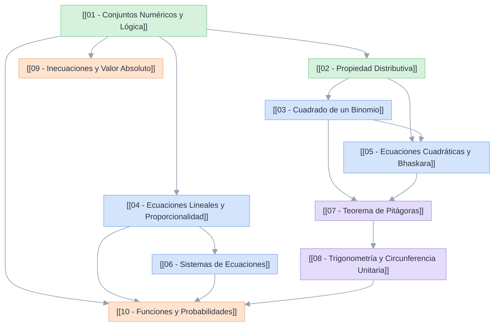

# Índice Maestro: Red de Conocimiento del Curso "El ABC de la Matemática"

Bienvenido a la red interconectada de notas matemáticas basadas en las clases de *El Traductor de Ingeniería*. En Obsidian, este documento actúa como el **nodo central** que vincula todas las áreas conceptuales.

---

## Grafo de Interconexiones Principales

---

## Red de Notas del Vault

1. **[[01 - Conjuntos Numéricos y Lógica]]**  
   *Bases del razonamiento, operaciones de conjuntos ($\cup, \cap$), implicación lógica ($P \Rightarrow Q$) y evolución del conteo ($\mathbb{N}, \mathbb{Z}, \mathbb{Q}, \mathbb{I}, \mathbb{R}$).*

2. **[[02 - Propiedad Distributiva]]**  
   *El pilar del álgebra: $a(b+c) = ab + ac$. Explicación intuitiva con áreas cuadradas y su aplicación para romper paréntesis.*

3. **[[03 - Cuadrado de un Binomio]]**  
   *Deducción rigurosa de $(a+b)^2 = a^2 + 2ab + b^2$ aplicando la [[02 - Propiedad Distributiva]] en lugar de memorizar recetarios.*

4. **[[04 - Ecuaciones Lineales y Proporcionalidad]]**  
   *Diferencia entre identidad y ecuación. Resolución con operaciones simétricas en ambos miembros y la [[02 - Propiedad Distributiva]]. Regla de tres simple.*

5. **[[05 - Ecuaciones Cuadráticas y Bhaskara]]**  
   *Resolución de $ax^2 + bx + c = 0$ completando cuadrados utilizando el [[03 - Cuadrado de un Binomio]] de forma inversa y demostración de la fórmula general.*

6. **[[06 - Sistemas de Ecuaciones]]**  
   *Resolución simultánea $2 \times 2$. Métodos de sustitución e igualación basados en [[04 - Ecuaciones Lineales y Proporcionalidad]] e interpretación gráfica.*

7. **[[07 - Teorema de Pitágoras]]**  
   *Demostración geométrica del área con cuadrados inscriptos apoyada en el [[03 - Cuadrado de un Binomio]]. Relación $h^2 = a^2 + b^2$.*

8. **[[08 - Trigonometría y Circunferencia Unitaria]]**  
   *Definición de Seno, Coseno y Tangente en el círculo de radio 1. Deducción del Teorema del Seno y Teorema del Coseno conectados con el [[07 - Teorema de Pitágoras]].*

9. **[[09 - Inecuaciones y Valor Absoluto]]**  
   *Desigualdades, cambio de sentido al multiplicar/dividir por negativos y resolución de $|x| \le a$ y $|x| \ge a$.*

10. **[[10 - Funciones y Probabilidades]]**  
    *Concepto de función $y = f(x)$, variables independientes y dependientes, intersección de gráficas de [[06 - Sistemas de Ecuaciones]] y probabilidad condicional con [[01 - Conjuntos Numéricos y Lógica]].*

11. **[[99 - Glosario Rápido]]**
    *Cheatsheet de nomenclatura: cada término con "=" y su definición mínima, organizado por tema (conjuntos, lógica, ecuaciones, geometría, probabilidad) y una tabla final de símbolos.*

12. **[[98 - Errores Comunes]]**
    *Las trampas clásicas del curso: cada error aparece con su corrección, la raíz conceptual del despiste y la nota que lo corrige. Consultarlo antes de cualquier examen.*

13. **[[97 - Temas Pendientes por Agregar]]**
    *Ruta de crecimiento del vault: temas futuros en formato checklist, cada uno con su nota raíz de la red actual.*

---

> [!TIP] Modo de uso en Obsidian
> Presiona `Ctrl + G` (o `Cmd + G` en macOS) para abrir la **Vista de Grafo (Graph View)** y observar las conexiones dinámicas entre las notas.
